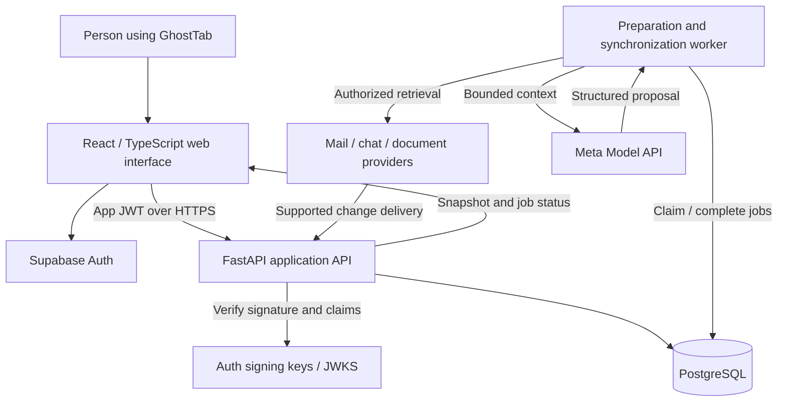

# GhostTab architecture

Updated October 27, 2026. **Current slice:** task/evidence storage, durable jobs,
Meta adapter, Google Calendar adapter, and the broader interface are implemented
locally. Live Calendar and synthetic Meta flows are verified; cloud deployment is
not. Sections below describe the wider target; [setup.md](setup.md) records current limits.

**Oct 27 verification:** local Google OAuth, event import/manual refresh and
controlled Meta preparations using synthetic sources have succeeded. Cloud
deployment and hosted identity remain unverified. Today readiness uses owner-scoped
task metadata (`source_count` for active evidence and `calendar_event_id` for exact
event association); displaying readiness performs no inference. Calendar statuses
reflect saved context, not an automatic freshness check against Google.

GhostTab prepares the context for a person's next task across messages,
documents, meetings, and work systems. A campaign approval, client meeting,
operations request, and code review share the same task/evidence model.
Developer-specific features are optional extensions.

## 1. Verified foundation

```text
React browser UI at 127.0.0.1:5173
  -> Vite development proxy /api
    -> FastAPI at 127.0.0.1:8000
      -> GET /api/health
```

| Area | Implemented |
| --- | --- |
| Interface | React 19.3.1, TypeScript 6.0.3, Vite 8.3.5, responsive CSS |
| Behavior | Empty workspace; typed and runtime-validated health response; five-second request timeout and retry |
| API | FastAPI, Uvicorn, Pydantic settings/response models; development OpenAPI docs |
| Verification | TypeScript, ESLint, Ruff, six API tests, separate frontend/backend GitHub Actions jobs |
| Reproducibility | npm and Python dependency locks; local virtual environment; setup documentation |

The foundation table above is the starting milestone. The current slice adds
SQLAlchemy 2/Alembic, SQLite locally and PostgreSQL support, owner-scoped operations,
manual task/evidence entry, immutable evidence versions, persisted jobs/snapshots/
drafts/usage, and separate worker execution. TanStack Query polls active preparations.
Local identity is loopback-only; Supabase JWT verification and existing-user sign-in
are implemented but have not been exercised with a live Supabase project.

Google Calendar is the first confirmed source. Its adapter provides read-only OAuth
with encrypted tokens, event selection and manual refresh. Mail/chat/docs, scheduled
polling and push delivery are future work. Meta requests are disabled by default.
Provider tests use mocked responses; live OAuth and synthetic inference were separately verified on Oct 27.
No paid hosting resource was provisioned; development remains local with credit-backed inference.

The worker uses one structured Meta request per attempt, at most three attempts
per generation. It reserves estimated cost atomically, renews leases, validates
exact citation spans, and fences publication against changed inputs and old leases.
It does not auto-enqueue replacement preparation after a source change: the user
requests refresh. Removed evidence blocks dependent snapshots immediately. Historic
source versions remain stored; physical purge/retention is future work.

Draft saves require `draft` and `expected_draft`, plus the visible `snapshot_id`
query parameter. The task lock serializes comparison and saving; mismatched saved
text returns 409 without overwriting it. Retrying the same desired saved text is
idempotent. Draft whitespace is preserved exactly. No schema migration is needed.
The editor retains unsaved text on refetch/new briefs, requires explicit conflict
resolution, and warns before leaving. No private drafts are written to browser
storage. See [development priorities and browser QA](development-plan.md).

There is no production deployment, local Git bridge or general connector catalog yet.
`/api/health` proves process liveness, not connector or worker readiness. The
interactive design concept shown in chat is not application functionality.

## 2. Target deployment

Use one modular Python application with separate API and worker processes. The
proposed first hosting arrangement is Render for the API/web process and worker,
plus Supabase for managed PostgreSQL and application authentication. Nothing is
provisioned yet; hosting is a separate cost from inference credits.



The API and worker share domain code and one deployable image, with different
entrypoints. The API handles short requests; the worker handles slow retrieval,
inference, synchronization and refresh. PostgreSQL holds durable state and jobs.
Redis, Kafka, a separate vector database, and a general DAG engine are deferred.

In production, FastAPI serves the compiled Vite assets and `/api` from the same
origin. Register API routes and the asset mount before the SPA fallback; an
unknown `/api` route must return an API error, not `index.html`. Vite is a local
development server and build tool, not the production application server.

## 3. Frontend and application modules

The planned frontend has three destinations: **Today**, **Workspaces**, and
**Connections**. A workspace presents the task brief, next step, source excerpts,
unknowns, freshness, and editable drafts. React Router and TanStack Query are
proposed for navigation and server-state caching. Poll active jobs initially;
WebSockets are unnecessary for the first status flow.

The backend remains a modular monolith:

| Module | Responsibility |
| --- | --- |
| Identity | JWT validation, user mapping, tenant membership, application authorization |
| Connections | Provider OAuth, allowed resources, encrypted credentials, revocation |
| Ingestion | Initial sync, verified events, cursors, normalization and source versions |
| Tasks/evidence | Task candidates, user corrections, provenance and source relationships |
| Preparation | Bounded retrieval, Meta synthesis, validation and snapshot publication |
| Freshness | Changed dependencies, newly relevant items and obsolete generations |
| Jobs/usage | Durable processing, leases, retries, model usage and failure reporting |
| Actions | Drafts first; separately authorized external effects when implemented |

Provider adapters expose a common capability interface: authorize, list selected
resources, retrieve items, normalize content, synchronize changes and revoke.
Webhook and polling capabilities differ by provider; the common interface must
not pretend that every provider supports identical events or actions.

Begin with bounded scheduled sync and manual refresh where push setup is not
ready; label polling honestly. Gmail push arrives through Google Cloud Pub/Sub
and supplies a history hint, not full messages: call `history.list` and renew
watches. Drive notifications prompt change-feed/object retrieval. Slack events
require raw-body signature and timestamp verification. Respect provider-specific
limits and `429`/`Retry-After`; do not assume generic polling intervals. See
[Gmail push](https://developers.google.com/workspace/gmail/api/guides/push),
[Drive changes](https://developers.google.com/workspace/drive/api/guides/manage-changes),
and [Slack rate limits](https://docs.slack.dev/apis/web-api/rate-limits/).

## 4. Identity and access boundaries

Application sign-in and provider authorization are separate. A Supabase session
identifies the GhostTab user. Connecting Google or Slack authorizes specific
source access; it does not replace application authorization.

FastAPI verifies short-lived application JWTs using a maintained verification
library and the configured issuer's JWKS. Validate signature, permitted
algorithm, issuer, audience and expiry; cache signing keys with rotation-aware
refresh. Map `sub` to a local user and derive tenant membership server-side.
Never trust a browser-supplied tenant ID as proof of access. See
[Supabase JWT guidance](https://supabase.com/docs/guides/auth/jwts).

For the MVP, imported evidence and its derived snapshots are **owner-private**.
Future membership in the same organization must not automatically reveal a
person's mailbox or private messages. Authorization requires both membership
and a valid resource grant for that principal. Enforce it before retrieval,
before including content in a model request, and before returning evidence,
drafts or snapshots.

Provider access/refresh tokens remain encrypted server-side. The encryption key
is server-managed and separate from database content; model credentials and
privileged database keys never enter `VITE_*` variables. Token rotation,
reconnection and revocation are explicit connection states.

Use PostgreSQL access controls and, where correctly configured, Supabase row-level
security as additional protection. RLS does not replace API checks: privileged
roles can bypass it, and a browser JWT is not automatically applied to a backend
database connection. For the MVP, application data flows through FastAPI; revoke
unnecessary public grants on application tables and keep credential storage out
of browser-accessible schemas. Use least-privilege database roles. See
[Supabase RLS documentation](https://supabase.com/docs/guides/database/postgres/row-level-security).

## 5. Persistence and provenance

SQLAlchemy 2 and Alembic are proposed for persistence and migrations. PostgreSQL
is the system of record. These are logical entities, not a requirement to create
every table in the first migration:

| Entity | Essential information |
| --- | --- |
| Users, tenants, memberships | Auth subject, workspace boundary and membership |
| Connections, resource grants | Owner, provider identity, scopes, selected resources, credential reference, grant epoch and sync cursor |
| Source items | Stable provider ID, connection, kind, original URL, current version, deletion status |
| Source versions | Immutable normalized content/excerpt, provider revision, checksum, author and observation times |
| Tasks | Owner, task lifecycle, origin, due date, user confirmation/corrections |
| Task evidence | Association to sources with inclusion reason and user overrides |
| Snapshots, snapshot dependencies | Immutable prepared output, exact input versions, generation and provenance |
| Events, jobs | Delivery deduplication, durable work, retries, lease and failure state |
| Model runs | Provider/model, prompt version, usage, latency, validation and estimated cost |
| Action drafts | Proposed content and parameters, separate from any external execution |

Combine small provider-specific metadata and resource-selection rules in JSONB
when useful. Keep owner/tenant IDs, unique provider identities, source versions,
dependency relationships and idempotency keys explicit and indexed. Start with
text excerpts; object storage is introduced only when attachment handling needs
it. Apply retention and deletion to source data and derived material together.

A snapshot input fingerprint includes source version IDs, task/query rules,
grant epochs, prompt version, exact model ID and generation settings. A hash
detects identical inputs; it does not prove content accuracy. Keep the underlying
manifest so the result is inspectable and reproducible.

## 6. End-to-end example

The first acceptance flow is a nontechnical task: **review a launch brief**.

1. The user signs in, connects authorized mail/chat/document resources, and
   selects a request to prepare.
2. The API records the task and durable preparation job, returning `202`.
3. The worker retrieves the request and directly linked discussion/document.
   It records source versions and checks grants before use.
4. Retrieval starts with explicit links, stable IDs and user selection. Expand
   with bounded PostgreSQL full-text search when needed. Embeddings are a later
   option if evaluation demonstrates missed relevant context.
5. The worker constructs a bounded evidence packet with source IDs and excerpts.
   Meta Model API uses `muse-spark-1.3` in Standard mode by default. Muse Wonder
   is an optional evaluated escalation, not a requirement for each task.
6. The model proposes a structured brief, claims with evidence IDs, open
   questions, next steps and a draft. Source content is data, never authority to
   run tools or change permissions.
7. The server validates the output schema and evidence references. Unsupported
   claims remain unresolved or require review; a valid citation does not prove
   that its attached claim is true.
8. A short transaction publishes the snapshot only if its task generation,
   input versions and grants are still current. Otherwise the result is
   superseded and a current generation is prepared.
9. The UI displays context and an editable reply draft. Sending is a separate
   user-approved operation when that capability exists.

## 7. Source change and refresh

This shows a provider-supported event path. Scheduled/manual synchronization
enters the same retrieval/versioning pipeline without a provider webhook.

```mermaid
sequenceDiagram
  participant P as Source provider
  participant A as FastAPI
  participant D as PostgreSQL
  participant W as Worker
  participant M as Meta Model API
  participant U as Interface
  P->>A: Changed item / verified event
  A->>D: Persist event and sync job atomically
  A-->>P: Acknowledge durable receipt
  W->>D: Claim job with lease
  W->>P: Fetch authorized latest item
  W->>D: New version; mark affected snapshots stale
  W->>D: Match newly relevant items against task rules
  U->>A: Poll active task/job
  A-->>U: Stale; refreshing
  W->>M: Current bounded evidence packet
  M-->>W: Proposed replacement
  W->>D: Validate generation/grants; publish replacement
  U->>A: Poll
  A-->>U: Fresh snapshot with changes
```

Existing dependencies identify many affected tasks, but are insufficient alone.
A newly arrived message may be relevant without appearing in the old snapshot.
Re-run bounded association rules for active tasks, using direct links, project
rules and query matches. Relevance is a separate decision from source revision.

Keep freshness separate from task lifecycle and preparation status. A task can
be waiting on another person while its context is stale. Preserve older
snapshots visibly during normal refresh. **On revocation, block access to
derived snapshots immediately**, then rebuild without the source or delete
derived content according to retention policy; stale marking alone is unsafe.

## 8. Durable work and API contract

Accept an event and enqueue its work in one PostgreSQL transaction. The worker
claims jobs in a short transaction using row locks and `SKIP LOCKED`, stores a
lease, and commits before making provider/model calls. Heartbeats extend active
leases; a reaper makes expired leases eligible for bounded retry. See
[PostgreSQL locking clauses](https://www.postgresql.org/docs/current/sql-select.htm).

Use at-least-once processing and idempotent effects. Deduplicate provider delivery
IDs separately from task/input fingerprints. Cap attempts, back off transient
failures, and expose terminal failures. Never hold database locks during model
inference. Render's worker is a long-running process, not durable storage by
itself; see [background workers](https://render.com/docs/background-workers).

```text
POST /api/tasks/{id}/prepare
  -> 202 { job_id, task_id, status_url }
GET /api/jobs/{id}
  -> { status, stage, attempt, error_code?, snapshot_id? }
GET /api/tasks/{id}/workspace
  -> { task, preparation, freshness, snapshot?, missing_access? }
POST /api/tasks/{id}/refresh
  -> 202 { job_id, task_id, status_url }
```

These routes are proposed. Every lookup checks ownership and current grants;
predictable IDs are not authorization. Repeated prepare requests reuse work for
the same current input rather than creating duplicates.

| Failure | Required behavior |
| --- | --- |
| Duplicate event | Return successful acknowledgement after finding the durable duplicate |
| Provider timeout/rate limit | Retry with bounded backoff; expose lag and incomplete evidence |
| Expired authorization | Pause connection, request reconnection, block unauthorized derived content |
| Invalid model output | Record validation failure; bounded repair/retry; no ready snapshot from invalid data |
| Worker crash | Lease expires; retry without duplicating task/snapshot effects |
| New input during inference | Reject obsolete publication; prepare latest generation |
| Model budget exhausted | Keep valid existing context; show preparation unavailable and preserve manual inputs |

## 9. Deployment and evolution gates

Before a connected release: prove owner isolation, safe connection/revocation,
one real Meta-backed preparation, durable restart recovery, new-source matching,
and a measured refresh. Add HTTPS configuration, production secrets, migrations,
database backups, structured redacted logs and readiness checks at deployment.

Scale only when measurements justify it: more worker replicas for queue lag,
provider-aware concurrency for rate limits, query/index improvements for database
latency, object storage for attachments, and semantic retrieval for demonstrated
recall gaps. Broader sharing, additional ecosystems, server-sent events and an
engineering local bridge each require their own acceptance criteria.
